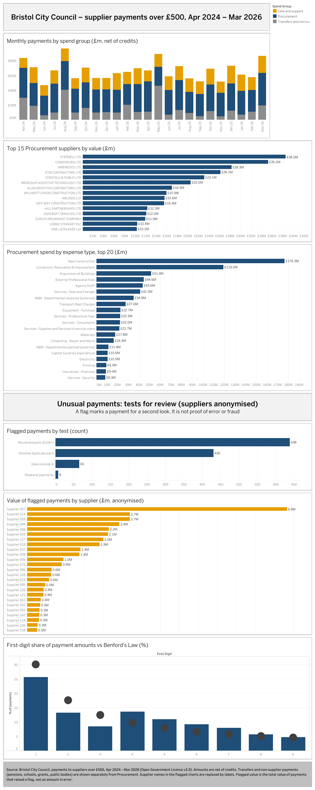
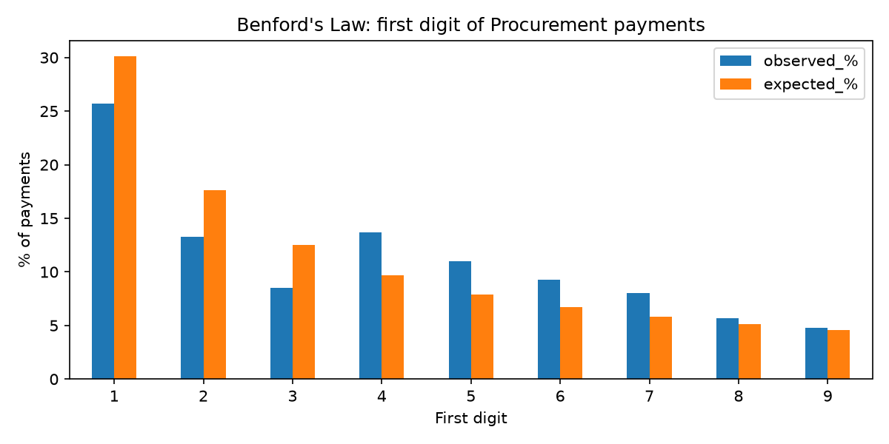

# Procurement: Spending and Unusual Payments

Audit-style analysis of **Bristol City Council supplier payments over £500** (April 2024 to March 2026): where the money goes, how concentrated it is, and which payments deserve a second look. Built with Python, SQL (SQLite) and Tableau.

**[View the interactive dashboard on Tableau Public](https://public.tableau.com/app/profile/shatabdi.kashyap/viz/BristolCityCouncilSupplierPaymentsandUnusualPayments/Procurementspendandunusualpayments)**

## The question

If you were an auditor opening this data for the first time, what would you check first? The council publishes every payment over £500. I combined 24 monthly files, cleaned and reconciled them, split genuine supplier spend from transfers, and ran a set of standard audit tests to flag payments for review.

## Key findings

- **141,930 payment lines, about £1.597bn net of credits.** Procurement is £808.5m (50.6%), care and support is £437.4m (27.4%), and transfers and non-supplier payments (pensions, schools, grants, public bodies) are £351.2m (22.0%).
- **Procurement spend grew modestly year on year:** £400.3m in 2024/25 to £408.1m in 2025/26 (+1.9%), while the number of payments fell 4.9%. Care and support grew faster (+8.8%), and transfers fell 18%.
- **Spend is concentrated.** Across 3,345 Procurement suppliers, 30 account for half of the spend and 152 for 80%.
- **Capital works dominate.** New construction, conversion and renovation, and acquisition of buildings are the three largest expense types.
- **215 possible duplicate pairs** (same supplier, date, amount, spend type and service area, £5,000 or more), worth up to £5.9m. A priority list of 22 payments, where the pair is also a round amount, is about £2.28m; roughly £1.1m would be at risk if one payment per pair were an overpayment.
- **No bunching below approval limits** was found, using illustrative limits tested against control amounts.
- **Round amounts:** 6.3% of payments of £10,000 or more are exact multiples of £1,000, concentrated in a few suppliers (law firms handling property purchases and fixed-fee or instalment arrangements).
- **Weekend payments are rare:** 13 of 141,930, of which 8 are Procurement.
- **Benford's Law:** the first-digit distribution departs from the expected one (MAD 0.0282, or 0.0214 on unique amounts). Repeated fixed rates explain part of this, so it is used as a dataset-level check only.

In total, **1,093 Procurement payments carry at least one flag.** A flag marks a payment for review. It is not proof of error or fraud.

## Recommendations

1. Check the 22 priority payments against invoices and remittance records before anything else.
2. Publish invoice numbers with the payment data. Without them, a true duplicate cannot be told apart from a legitimate repeat payment.
3. Run the duplicate-pair test as a routine monthly control.
4. Review suppliers with a high share of round-amount payments to confirm they are instalment or fixed-fee arrangements.

## How it works

1. `01_load_and_combine`: reads 24 monthly CSVs with inconsistent encodings and column layouts, and combines them.
2. `02_data_quality`: checks missing values, amount formats, dates, and the largest payments and credits.
3. `03_clean`: cleans text and amounts, standardises supplier names, flags credits, zero amounts and date mismatches (nothing is deleted), assigns each payment to a spend group, and reconciles against the council's own file totals.
4. `04_load_sqlite`: loads the clean data into a SQLite database with indexes.
5. `05_sql_analysis`: spend by financial year and group, top suppliers, and concentration using window functions.
6. `06_unusual_payments`: duplicates, bunching below limits, round amounts, weekend payments and Benford's Law, combined into a risk score and a priority list.
7. `07_export_for_tableau`: exports small summary files (with flagged suppliers anonymised) for the dashboard.

To reproduce, place the raw monthly files in `data/raw/` and run the notebooks in order.

## Data

Bristol City Council, "payments to suppliers over £500", April 2024 to March 2026, published under the Open Government Licence v3.0. The raw monthly files are in `data/raw/`.

## Honest limits

- The data has **no invoice numbers**, so no flagged payment can be confirmed as an error.
- A few public bodies (for example a courts service and a combined authority) remain in the Procurement group.
- June 2025 could not be reconciled to a council total, because that file has no total row. The other 23 months reconcile.
- The approval limits used in the bunching test are illustrative; the council's real limits are not in the data.
- Supplier names in the flagged charts and exports are replaced with labels (Supplier 001, 002 and so on) so that review flags are not read as accusations.

## Tools

Python (pandas, numpy, matplotlib), SQLite and SQL (window functions, CTEs), Tableau Public, Git and GitHub.
